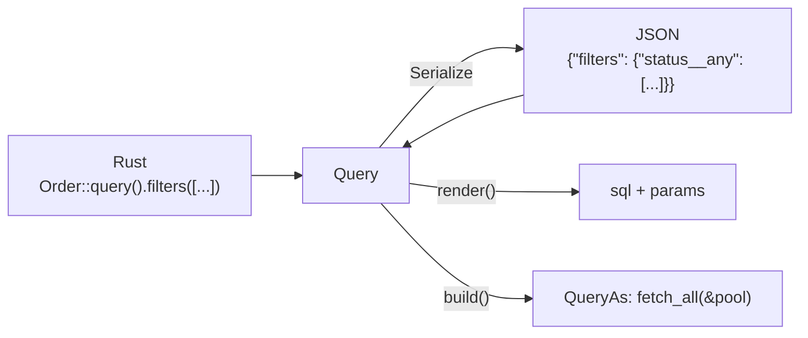

# Query builder

A `WHERE` clause as data: a query type tailored to one table, built from typed
Rust values or parsed from succinct JSON, that renders to the `(sql, params)`
pair `sqlx` executes.

The code lives in `crates/dbkit/src/query/`, and `#[derive(DbModel)]` generates
the per-model parts: `<Model>Column`, the column tags, the capability impls,
`<Model>Columns` and `<Model>::columns()`/`query()`. See
[Where the code lives](#where-the-code-lives).

## Goal

One query type per table, `Query<OrderColumn>`, with three faces:



- The Rust face is type-checked: a column handle knows its value type, so
  `c.total.eq("500")` does not compile and a filter on a column the table does
  not have cannot be constructed at all.
- The JSON face is the same tree in a flat, key-per-filter form under a
  `filters` key, with `limit` and `offset` beside it. It parses into the same
  `Query<C>`, so the two faces converge on one representation instead of two
  code paths, and a Rust-built query serializes back to the same JSON.
- Rendering is the only exit: `render()` produces the SQL text and the
  parameter list, and `build()` wraps the same pair as a `QueryAs` to run, with
  every value bound and every identifier quoted from model metadata, never from
  the request.

### Typed in Rust

```rust
let c = Order::columns();

let query = Order::query()
    .filters([
        c.status.any(["open", "paid"]),
        c.deleted_at.is_null(),
        Filter::or([
            c.total.between(100, 500),
            Filter::and([c.vip.eq(true), c.tags.contains("gift")]),
        ]),
    ])
    .limit(20)
    .offset(40);

let built = query.render()?;

assert_eq!(
    built.sql,
    "SELECT * FROM \"orders\" \
     WHERE \"status\" = ANY($1) \
     AND \"deleted_at\" IS NULL \
     AND (\"total\" BETWEEN $2 AND $3 \
          OR (\"vip\" = $4 AND $5 = ANY(\"tags\"))) \
     LIMIT $6 OFFSET $7"
);
assert_eq!(
    built.values_json(),
    vec![
        json!(["open", "paid"]),
        json!(100),
        json!(500),
        json!(true),
        json!("gift"),
        json!(20),
        json!(40),
    ]
);
```

`values` is `Vec<Arc<dyn Bind>>`, so a readable assertion goes through
`values_json()`; a type-exact one uses `Bind::eq_dyn`, which is what the
snapshot tests do (`100i64` does not equal `100i32`).

`is_null` binds nothing, so `deleted_at` has no entry in `values` and does not
advance the placeholder numbering: the count is the number of leaves that carry
a value. `limit` and `offset` are `u32` in the API and bind as `i64` through
`i64::from`, since `LIMIT`/`OFFSET` take a bigint; they are appended after every
filter value.

The value types are the model's own. `c.status` is
`ColumnRef<OrderStatusTag, OrderColumn, String>` because the field is `String`;
`c.total` is `ColumnRef<OrderTotalTag, OrderColumn, i64>`; `c.vip` is
`ColumnRef<OrderVipTag, OrderColumn, bool>`; and `c.tags` is
`ColumnRef<OrderTagsTag, OrderColumn, Vec<String>>`, so `contains` takes one
`String` rather than a list. A column handle only exposes operators that make
sense for its type, and the argument type is the field's type, so mistakes are
compile errors:

```text
error[E0308]: mismatched types
  --> src/orders.rs:42:19
   |
42 |     Order::query().filters([c.total.eq("500")])
   |                                       ^^^^^ expected `i64`, found `&str`
```

A newtype keeps its identity: a column of type `Email` takes `Email`, not
`String`, so a filter cannot be built from an unvalidated string.

### The same query as JSON

```json
{
  "filters": {
    "status__any": ["open", "paid"],
    "deleted_at": null,
    "or": [
      { "total__between": [100, 500] },
      { "and": [{ "vip": true }, { "tags__contains": "gift" }] }
    ]
  },
  "limit": 20,
  "offset": 40
}
```

`Query::<OrderColumn>::parse(&body)` yields the same `Query<OrderColumn>` the
Rust block built, and serializing that value produces this payload again.
`filters` holds the tree; `limit` and `offset` sit beside it, because paging is
not a filter and the endpoint already knows the table.

### Rendered SQL

Both faces render to the same statement:

```sql
SELECT * FROM "orders"
WHERE "status" = ANY($1)
  AND "deleted_at" IS NULL
  AND ("total" BETWEEN $2 AND $3
       OR ("vip" = $4 AND $5 = ANY("tags")))
LIMIT $6 OFFSET $7
-- params: [["open", "paid"], 100, 500, true, "gift", 20, 40]
```

### `any` becomes one array parameter

`any` is where the payload and the SQL diverge most. `IN ($1, $2, …)` would put
one placeholder per element, so the SQL text would change with the request: a
five-element list and a fifty-element list become two different prepared
statements, and an unbounded list can build SQL of unbounded size.

`= ANY($1)` takes the whole list as one parameter:

```sql
SELECT * FROM "orders" WHERE "status" = ANY($1)
-- params: [["open", "paid"]]
```

- One placeholder per `any`, whatever the list length: the statement text is a
  function of the filter *shape*, not of the data, so `sqlx` reuses one prepared
  statement for every request of that shape. In the larger example above the
  `any` list is `$1`, and the rest of the tree shifts by one rather than by the
  list's length.
- The parameter list nests: the array is a single entry, so `params` is
  `[["open", "paid"]]` rather than two flat strings.
- The array element type comes from the column, so `Vec<T>` binds where `T` is
  the column's mapped type. Verified: `uuid`, `int8`, `timestamptz` and
  `varchar(20)` columns each accept `Vec<Uuid>`, `Vec<i64>`,
  `Vec<DateTime<Utc>>` and `Vec<String>` without a cast, so the map that serves
  scalars serves arrays.
- In JSON this is the key `"status__any": ["open", "paid"]`; the array form is a
  property of the rendering, not of the payload.

The spelling matters: `IN ($1)` with an array parameter is a type error, not a
shorthand. Verified against PostgreSQL 18:

```text
select id from orders where status = any($1)   -- bound &["open", "paid"]
  -> rows 1, 2, 3
select id from orders where status in ($1)     -- bound &["open", "paid"]
  -> ERROR: operator does not exist: character varying = text[]
```

`IN` compares a scalar against scalars, so the right-hand side must be a list of
scalars; `= ANY(array)` is the operator that takes an array. They are not
interchangeable spellings of one idea.

Semantics, also verified:

- An empty array is `false`, not "match everything": `x = ANY('{}')` returns
  `false`, so `any []` selects nothing and `not_any []` matches every row.
- A `NULL` element behaves like `IN (…, NULL)`: `= ANY(array[open, NULL])` and
  `IN ('open', NULL)` both match only the non-null hits.
- A `varchar(n)` column accepts a `text[]` parameter without a cast.

Because of the first point, an empty `any` list is an error rather than a silent
"no rows".

### The JSON grammar

A query object holds `select`, `filters`, `limit` and `offset`, and nothing
else:

```json
{
  "filters": { "status__any": ["open", "paid"] },
  "limit": 20,
  "offset": 40
}
```

- `select` is the projection: an array of column names. It is absent when every
  column is wanted, and an empty array is an error rather than a second
  spelling of "every column".
- `filters` is the filter tree. It is absent when there is nothing to filter,
  which is why `{"limit": 20}` is a valid request for the first page of every
  row; an empty object is the same as absent.
- Inside `filters` a key is a column name, optionally followed by `__` and an
  operator: `"status__any"`, `"total__between"`.
- A key with no operator suffix means `eq`: `"vip": true` is
  `"vip__eq": true`.
- The operator suffix is the snake_case `FilterOperator` name: `eq`, `neq`,
  `gt`, `gte`, `lt`, `lte`, `like`, `ilike`, `not_like`, `not_ilike`, `any`,
  `not_any`, `contains`, `not_contains`, `contains_all`, `not_contains_all`,
  `overlaps`, `not_overlaps`, `is_null`, `is_not_null`, `between`,
  `not_between`. The same vocabulary is the method name on a column handle, so
  there is one list to learn.
- Keys at one level combine with `AND`. Nesting is explicit through the
  reserved keys `and` and `or`, each holding an array of filter objects:
  `{"or": [{...}, {...}]}`.
- A key inside `filters` is resolved in this order, so no shadowing is implicit:
  1. The whole key as a column name, which means `eq`.
  2. The whole key as `and` or `or`.
  3. The key split at its *last* `__`, left side as a column, right side as an
     operator suffix. This is what lets a column named `foo__any` still be
     filtered as `"foo__any": value`.
  A key that matches none of the three is an error naming the column list, not a
  silently ignored filter. The cost of that order is a rare ambiguity: with
  columns `foo` and `foo__any`, the key `"foo__any"` is the column, so `any` on
  `foo` is unreachable. Renaming one column is cheaper than a positional
  syntax.
- The wrapper is what makes the reserved keys cheap. Paging is not a filter, so
  it does not belong in the tree, and putting it outside means the filter level
  holds only columns plus the two combinators. A column named `limit`, `offset`
  or even `filters` is therefore an ordinary column inside the filter object,
  and the nesting decides which one is meant:

  ```json
  { "filters": { "limit": 5 }, "limit": 20 }
  ```

  That filters on the `limit` column and then takes 20 rows. The combinators
  `and` and `or` are the only reserved keys left inside a level, and a column
  of that name wins there — see [Arbitrary nesting](#arbitrary-nesting).
- A key beside `filters` that is none of the four is an error naming them, so
  a payload in the older flat shape is rejected with a message rather than
  silently matching nothing.
- `null` is the short form of `is_null`: `{"deleted_at": null}` renders
  `"deleted_at" IS NULL`, and `{"deleted_at__neq": null}` renders
  `IS NOT NULL`.
- `any`, `not_any`, `overlaps`, `not_overlaps`, `contains_all` and
  `not_contains_all` take an array; `between` takes a two-element array;
  `contains` and `not_contains` take a scalar; `is_null` and `is_not_null` take
  `true`, since every JSON key needs a value. A value of the wrong shape is an
  error, not a coercion: `{"status": ["open"]}` says "use `any`".
- Key order is preserved, so parameter order is the order the client wrote,
  and serialization reproduces the request.
- A duplicate key is an error, at either level. `serde_json` would silently keep
  the last one.
- Serializing a level whose flat keys would collide falls back to an explicit
  `{"and": [...]}` list, which parses back to the same tree; see
  [Arbitrary nesting](#arbitrary-nesting).
- There is no `table` key: the endpoint is per model, and `C` already names the
  table. Cross-table queries are out of scope.
- `limit` and `offset` hold a non-negative integer. A negative or fractional
  value is a syntax error rather than a clamp.
- `select` keeps its order: an unknown name is an error naming the column list,
  a repeated name is one column, and `["total", "id"]` prints and renders in
  that order rather than being reordered to declaration order.

### Arbitrary nesting

The tree is a recursive enum, so any finite shape is expressible. This predicate
has three levels:

```text
A AND B AND (C OR (D AND E AND F))
```

```rust
let query = Order::query().filters([
    c.a.eq(1),
    c.b.eq(2),
    Filter::or([
        c.c.eq(3),
        Filter::and([c.d.eq(4), c.e.eq(5), c.f.eq(6)]),
    ]),
]);
```

```sql
WHERE "a" = $1 AND "b" = $2
  AND ("c" = $3 OR ("d" = $4 AND "e" = $5 AND "f" = $6))
-- params: [1, 2, 3, 4, 5, 6]
```

```json
{
  "filters": {
    "a": 1,
    "b": 2,
    "or": [
      { "c": 3 },
      { "and": [{ "d": 4 }, { "e": 5 }, { "f": 6 }] }
    ]
  }
}
```

Four rules keep this unambiguous:

- **A leaf handle returns `Filter<C>`, not `Leaf<C>`.** A `Vec` holds one element
  type, so the enum variant is what lets a single array mix leaves and groups.
- **The top level is an implicit `And`.** `Query::filters` appends to it. There
  is no `Query::and` or `Query::or`: with the top level already a conjunction,
  those names cannot tell "append here" from "nest a group", and either guess
  would be silent.
- **Nesting is only ever explicit.** `Filter::and` and `Filter::or` are the only
  ways to make a group, so the written shape is the rendered shape.
- **Every group is parenthesized.** SQL precedence (`AND` binds tighter than
  `OR`) never decides the meaning, so the tree round-trips exactly. This is why
  the inner `(D AND E AND F)` keeps its parentheses although `A AND B` needs
  none.

Degenerate shapes: `and([x])` renders `(x)`, and `and([])` is an error. A
single-child group is not collapsed, because collapsing would change the
serialized form.

Construction does not flatten either: `and([and([a, b]), c])` renders
`((a AND b) AND c)`. Flattening would be semantically safe, but it would rewrite
the caller's tree and change what serialization prints. `normalize()` — flatten
same-combinator nesting, drop single-child groups — is available but opt-in.

The JSON form has one constraint the tree does not: a duplicate key is invalid,
so an object can carry at most one `and` key and one `or` key. The serializer
therefore:

- emits one flat key per leaf child of the object's implicit `And`;
- emits one `or` key per `Or` group child, since each group is one key;
- falls back to an explicit `{"and": [ ... ]}` for the whole level when two
  group children share a combinator.

Inside an `and`/`or` array every child is its own object, so no two keys in one
object can collide, and the fallback never needs to merge siblings. That keeps
serialization structural: `filters([a, and([b, c])])` prints
`{"filters": {"a": 1, "and": [{"b": 2}, {"c": 3}]}}` and parses back to the same
tree rather than a flattened one, while `filters([and([a, and([b, c])])])` — one
group at the top — keeps both wrappers.

A column named `and` or `or` cannot be told apart from the combinator key, and
the column wins, so a group of that kind has no JSON spelling on such a model.
Serialization reports it rather than writing a payload that would parse back as
something else.

The depth cap of 8 applies to groups, so this example uses 2 of its 8.

## Worked examples

Most examples give the Rust call, the JSON that means the same thing, and the
SQL both produce; where a case has no JSON spelling (a projection, `normalize`)
only Rust and SQL are shown.

The model they share:

```rust
#[derive(DbModel)]
#[db(table = "orders")]
pub struct Order {
    #[db(primary_key)]
    #[db(pgtype = "uuid")]
    pub id: OrderId,

    #[db(pgtype = "varchar(20)")]
    #[db(query_ops(eq, any, ilike))]
    pub status: String,

    #[db(pgtype = "int8")]
    #[db(query_ops(gte, lt, between))]
    pub total: i64,

    #[db(pgtype = "bool")]
    #[db(query_ops(eq))]
    pub vip: bool,

    #[db(pgtype = "text[]")]
    #[db(query_ops(contains, overlaps, contains_all))]
    pub tags: Vec<String>,

    #[db(pgtype = "timestamptz")]
    #[db(query_ops(eq, neq))]
    pub deleted_at: Option<DateTime<Utc>>,
}
```

`c` below is `Order::columns()`. Each filterable column declares the operators
it accepts; `render()` rejects an operator outside that list, so the examples
only show declared ones. `is_null` and `is_not_null` are the exception: they are
always allowed, since they take no value and cannot be mistyped.

### One leaf

```rust
Order::query().filters([c.status.eq("open")])
```

```json
{ "filters": { "status": "open" } }
```

```sql
SELECT * FROM "orders" WHERE "status" = $1
-- params: ["open"]
```

The key has no suffix, so it is `eq`; `{"status__eq": "open"}` is the same
request. A top-level list never adds parentheses, because nothing else is
competing with it.

### A newtype key

```rust
let id = OrderId::parse("018f2b0e-...")?;

Order::query().filters([c.id.eq(&id)])
```

```json
{ "filters": { "id": "018f2b0e-..." } }
```

```sql
SELECT * FROM "orders" WHERE "id" = $1
-- params: ["018f2b0e-..."]
```

In Rust the argument is the newtype, and a borrow is fine because `DbValue`
generated `From<&OrderId>`. Over JSON the value is a string that the column's
`uuid` pg type parses, so the newtype's constructor never runs; filtering on a
malformed id matches nothing rather than failing. See [Newtypes](#newtypes).

### Several leaves are a conjunction

```rust
Order::query().filters([c.status.eq("open"), c.vip.eq(true)])
```

```json
{ "filters": { "status": "open", "vip": true } }
```

```sql
SELECT * FROM "orders" WHERE "status" = $1 AND "vip" = $2
-- params: ["open", true]
```

Key order is parameter order, so the JSON above and
`{"vip": true, "status": "open"}` produce the same predicate with the
parameters in the opposite order.

### A list

```rust
Order::query().filters([c.status.any(["open", "paid"])])
```

```json
{ "filters": { "status__any": ["open", "paid"] } }
```

```sql
SELECT * FROM "orders" WHERE "status" = ANY($1)
-- params: [["open", "paid"]]
```

One placeholder for the list; see
[`any` becomes one array parameter](#any-becomes-one-array-parameter).

### A range

```rust
Order::query().filters([c.total.between(100, 500)])
```

```json
{ "filters": { "total__between": [100, 500] } }
```

```sql
SELECT * FROM "orders" WHERE "total" BETWEEN $1 AND $2
-- params: [100, 500]
```

An open-ended range is two leaves, not a special operator:

```rust
Order::query().filters([c.total.gte(100), c.total.lt(500)])
```

```json
{ "filters": { "total__gte": 100, "total__lt": 500 } }
```

```sql
SELECT * FROM "orders" WHERE "total" >= $1 AND "total" < $2
-- params: [100, 500]
```

### Text

```rust
Order::query().filters([c.status.ilike("op%")])
```

```json
{ "filters": { "status__ilike": "op%" } }
```

```sql
SELECT * FROM "orders" WHERE "status" ILIKE $1
-- params: ["op%"]
```

`like` and friends exist only where the column type is `String`. A column whose
field is a newtype such as `Email` has `ColumnRef<Tag, OrderColumn, Email>`, so
`like` does not resolve; only the value operators are available there.

### Null

```rust
Order::query().filters([c.deleted_at.is_null()])
```

```json
{ "filters": { "deleted_at": null } }
```

```sql
SELECT * FROM "orders" WHERE "deleted_at" IS NULL
```

```rust
Order::query().filters([c.deleted_at.is_not_null()])
```

```json
{ "filters": { "deleted_at__neq": null } }
```

```sql
SELECT * FROM "orders" WHERE "deleted_at" IS NOT NULL
```

`is_not_null` is also a suffix, so `{"deleted_at__is_not_null": true}` means the
same thing; the `neq`-with-`null` spelling is the shorter one, and `neq` is the
only other operator that accepts `null`.

### Array column

```rust
Order::query().filters([c.tags.contains("rust")])
```

```json
{ "filters": { "tags__contains": "rust" } }
```

```sql
SELECT * FROM "orders" WHERE $1 = ANY("tags")
-- params: ["rust"]
```

The column holds the array and the parameter is one element, the reverse of
`any`. The multi-value question — "tags share anything with this list?" — is
`overlaps`, which takes the list:

```rust
Order::query().filters([c.tags.overlaps(["rust", "sql"])])
```

```json
{ "filters": { "tags__overlaps": ["rust", "sql"] } }
```

```sql
SELECT * FROM "orders" WHERE "tags" && $1
-- params: [["rust", "sql"]]
```

And the superset question:

```rust
Order::query().filters([c.tags.contains_all(["rust", "sql"])])
```

```json
{ "filters": { "tags__contains_all": ["rust", "sql"] } }
```

```sql
SELECT * FROM "orders" WHERE "tags" @> $1
-- params: [["rust", "sql"]]
```

`overlaps` and `contains_all` each bind one array parameter, so the statement
shape does not depend on the list length. `not_contains`, `not_overlaps` and
`not_contains_all` render the negation of the same three; `contains` is the only
one of the six that takes a scalar.

### Projection

```rust
Order::query()
    .select(&[c.id.column(), c.total.column()])
    .filters([c.status.eq("open")])
```

```json
{ "select": ["id", "total"], "filters": { "status": "open" } }
```

```sql
SELECT "id", "total" FROM "orders" WHERE "status" = $1
-- params: ["open"]
```

`select` takes anything that reduces to `Columns<C>`, through one trait:

```rust
pub trait IntoColumns<C: Column> {
    fn into_columns(self) -> Columns<C>;
}

impl<C: Column> IntoColumns<C> for C {}                          // a variant
impl<Tag, C: Column, T> IntoColumns<C> for ColumnRef<Tag, C, T> {} // a handle
impl<C: Column> IntoColumns<C> for Columns<C> {}                 // all(), a request
impl<C: Column, const N: usize> IntoColumns<C> for [C; N] {}     // a list
// and the borrowed forms of each list and of the set
```

The trait exists because handles are one type per column: `[c.id, c.total]` is
two different types, so the only step that erases the tag and the value type is
`column()`. Hence `.column()` on each element of a list, and nothing at all for
a single handle.

A tuple — `select((c.id, c.total))` — would remove the `.column()` and cannot
coexist with the single-column form: the blanket impl a tuple needs overlaps
the array, `Columns` and `&Columns` impls, and coherence rejects it. Choosing
tuples means writing `select((c.id,))` for one column, which is worse than the
`.column()` it saves.

Column order is the caller's — declaration order for `Columns::all()`, request
order otherwise — and two selections with the same columns in different orders
are not equal, because they render different SQL. An unknown name is a parse
error.

### Decoding a projection

A projection returns fewer columns than the row type has, so it decodes into
the model's select type, generated by `#[derive(DbSelect)]`:

```rust
let rows: Vec<OrderSelect> = Order::query()
    .select([OrderColumn::Status, OrderColumn::Total])
    .build()?
    .fetch_all(&pool)
    .await?;

assert!(rows[0].total.is_set());
assert!(rows[0].tags.is_absent());
```

Every column is a `Selected<T>`: `Set` when the query selected it, `Absent`
otherwise. A nullable column keeps its `Option` inside, so `Set(None)` is a
selected `NULL` and `Absent` is a column nobody asked for — the same
distinction `Patch` draws on the way in. The row reports its own projection
through `columns()`, so nothing has to be passed to decoding, and one select
struct serves `SELECT *` and every sparse projection of the table.

### Paging

```rust
Order::query()
    .filters([c.status.eq("open")])
    .limit(20)
    .offset(40)
```

```json
{ "filters": { "status": "open" }, "limit": 20, "offset": 40 }
```

```sql
SELECT * FROM "orders" WHERE "status" = $1 LIMIT $2 OFFSET $3
-- params: ["open", 20, 40]
```

`limit` and `offset` are bound like any other value, not interpolated: they are
integers from an untrusted request, and binding keeps the statement shape
constant too. They are not filters, so they sit beside `filters` rather than in
it, and `{"filters": {}}` is the same as no `filters` key at all. With only a
limit:

```rust
Order::query().filters([c.status.eq("open")]).limit(20)
```

```sql
SELECT * FROM "orders" WHERE "status" = $1 LIMIT $2
-- params: ["open", 20]
```

With neither, the clause is absent rather than `LIMIT ALL`:

```sql
SELECT * FROM "orders" WHERE "status" = $1
```

### A disjunction

```rust
Order::query().filters([Filter::or([
    c.status.eq("open"),
    c.vip.eq(true),
])])
```

```json
{ "filters": { "or": [{ "status": "open" }, { "vip": true }] } }
```

```sql
SELECT * FROM "orders" WHERE ("status" = $1 OR "vip" = $2)
-- params: ["open", true]
```

The group is parenthesized even at the top level, because the top level is an
`AND` that happens to have one child; dropping the parentheses would change
what the JSON `or` key means if another key were added beside it.

### Mixed depth

```rust
Order::query().filters([
    c.status.eq("open"),
    Filter::or([
        c.vip.eq(true),
        Filter::and([c.total.gte(100), c.total.lt(500)]),
    ]),
    c.tags.contains("gift"),
])
```

```json
{
  "filters": {
    "status": "open",
    "or": [
      { "vip": true },
      { "and": [{ "total__gte": 100 }, { "total__lt": 500 }] }
    ],
    "tags__contains": "gift"
  }
}
```

```sql
SELECT * FROM "orders"
WHERE "status" = $1
  AND ("vip" = $2 OR ("total" >= $3 AND "total" < $4))
  AND $5 = ANY("tags")
-- params: ["open", true, 100, 500, "gift"]
```

The level has two leaves and one `Or` group, so it keeps its flat leaf keys and
needs no `and` wrapper: a leaf is a key, a group is one key, and the two kinds
cannot collide.

### When a level needs the wrapper

Two `OR` children at one level cannot both be a flat `"or"` key:

```rust
Order::query().filters([
    Filter::or([c.status.eq("open"), c.vip.eq(true)]),
    Filter::or([c.total.lt(100), c.tags.contains("gift")]),
])
```

```json
{
  "filters": {
    "and": [
      { "or": [{ "status": "open" }, { "vip": true }] },
      { "or": [{ "total__lt": 100 }, { "tags__contains": "gift" }] }
    ]
  }
}
```

```sql
SELECT * FROM "orders"
WHERE ("status" = $1 OR "vip" = $2) AND ("total" < $3 OR $4 = ANY("tags"))
-- params: ["open", true, 100, "gift"]
```

The fallback is mechanical: the level's leaves would be flat keys and its two
groups would both want `"or"`, so the serializer writes `{"and": [...]}`
instead, one object per child. Parsing it back yields the identical tree, so the
JSON is structural rather than a lossy flat rendering.

### normalize

The same predicate, written redundantly:

```rust
Order::query().filters([Filter::and([
    c.status.eq("open"),
    Filter::and([c.vip.eq(true)]),
])])
```

```sql
-- before normalize()
SELECT * FROM "orders" WHERE ("status" = $1 AND ("vip" = $2))
-- after normalize()
SELECT * FROM "orders" WHERE "status" = $1 AND "vip" = $2
```

`normalize()` flattens same-combinator nesting and drops single-child groups. It
is opt-in because it rewrites the tree, and a rewritten tree serializes
differently from the one the caller wrote.

### Errors

Each rejected request names what is wrong. The payloads below show only the
`filters` object, since that is where each problem is:

```text
{ "statuss": "open" }
  unknown column `statuss`; expected one of: id, status, total, vip, tags,
  deleted_at

{ "status__betwen": [1, 2] }
  operator `betwen` is not known; expected one of: eq, neq, gt, gte, lt, lte, …

{ "status__any": [] }
  `any` needs at least one value

{ "status__any": "open" }
  `any` takes a list, got a string

{ "total": "500" }
  column `total` is int8, the value is a string

{ "deleted_at__eq": null }
  use `deleted_at`: null, or `deleted_at__neq`: null

{ "total__ilike": "5%" }
  operator `ilike` is not allowed on column `total`; its query_ops are: eq, neq,
  gt, gte, lt, lte
```

A key beside `filters` is rejected with the four that belong there:

```text
{ "vip": true }
  unknown key `vip`; a query takes `select`, `filters`, `limit` and `offset`
```

An empty projection is rejected rather than reading every column:

```text
{ "select": [] }
  a selection needs at least one column; omit `select` to read every column
```

The Rust face catches the value type and the unlisted operator at compile time
instead:

```text
c.total.eq("500")   error[E0308]: expected `i64`, found `&str`
c.total.ilike("5%") error[E0599]: no method `ilike` on `ColumnRef<_, _, i64>`
c.total.between(1, 2) error[E0599]: `OrderTotalTag: HasBetween<OrderColumn>`
                      was not satisfied
```

`is_null` is deliberately available on every column, nullable or not: `IS NULL`
on a `NOT NULL` column is valid SQL that matches nothing, and the handle has no
type-level record of nullability to reject it.

## Types

### Value model

Rust-side values are typed; JSON-side values are not. Both end up as one boxed
trait object behind an `Arc`, and the tree holds that, never
`serde_json::Value`:

```rust
/// One bound value: enough to bind, to compare in tests, and to serialize.
pub trait Bind: Debug + Send + Sync {
    fn bind(&self, args: &mut PgArguments) -> Result<(), sqlx::Error>;
    fn as_json(&self) -> serde_json::Value;
    fn eq_dyn(&self, other: &dyn Bind) -> bool;
    #[doc(hidden)]
    fn as_any(&self) -> &dyn Any;
}

impl<T> Bind for T
where
    T: Debug
        + PartialEq
        + Serialize
        + Send
        + Sync
        + 'static
        + Type<Postgres>
        + for<'q> Encode<'q, Postgres>,
{
    fn bind(&self, args: &mut PgArguments) -> Result<(), sqlx::Error> {
        args.add(self).map_err(sqlx::Error::Encode)
    }

    fn as_json(&self) -> serde_json::Value {
        serde_json::to_value(self).expect("a filter value serializes")
    }

    fn eq_dyn(&self, other: &dyn Bind) -> bool {
        other.as_any().downcast_ref::<T>() == Some(self)
    }

    fn as_any(&self) -> &dyn Any {
        self
    }
}
```

- `Type` is not dyn-compatible: `type_info()` is an associated function, so
  `Box<dyn Type<Postgres>>` is `E0038`. This `Bind` shim is object-safe because
  the blanket impl resolves `Type` and `Encode` statically for each concrete
  `T`, and the trait object only exposes `&self` methods. Verified: one
  `Vec<Box<dyn Bind>>` holds `i64`, `String`, `bool`, `Vec<String>`, `Uuid`,
  `DateTime<Utc>`, a transparent newtype and an `Option` of one, and binds all
  of them.
- No `Clone` bound. `args.add(self)` binds `&T`, and sqlx implements `Encode`
  for `&T`, so a newtype that is not `Clone` still works as a filter value.
- `as_json` is what keeps `Query<C>` serializable: the tree could not go back
  to JSON otherwise, and `Serialize` for the whole query is a requirement.
- `eq_dyn` is what keeps `Built::values` assertable. Because the blanket impl
  knows `T`, it downcasts the other side; a value of a different concrete type
  compares unequal (`100i64` vs `100i32` is `false`), so the assertion is
  type-exact rather than JSON-loose.
- `PgArguments` is `Default` and `Arguments::add` is public, so arguments are
  assembled before a query exists and handed to `query_as_with`. Anything that
  `Encode`s is bindable, including `numeric` through sqlx's `rust_decimal` or
  `bigdecimal` feature, which a hand-rolled enum would have had to grow a
  variant for.
- `u32` still has no `Bind` impl of its own, because `u32` has no `Type`. Paging
  converts: `i64::from(limit)` binds, which is the PostgreSQL parameter type for
  `LIMIT` and `OFFSET` anyway.

JSON has no types, so the deserializer is the one place that names concrete
types. It cannot ask sqlx for one — `Type` describes a type but cannot build a
value from JSON — so there is one list, and sqlx decides which name denotes
which entry:

```rust
macro_rules! bindable {
    ($($shape:ident => $ty:ty),* $(,)?) => {
        $(
            if <$ty as Type<Postgres>>::compatible(&PgTypeInfo::with_name(base)) {
                /* check the JSON shape, then serde_json::from_value */
            }
        )*
    };
}

bindable! {
    Bool => bool,
    Number => i16,
    Number => i32,
    Number => i64,
    Number => f32,
    Number => f64,
    Text => String,
    Text => Uuid,
    Text => NaiveDate,
    Text => DateTime<Utc>,
    Any => Value,
}
```

- `Type::compatible` is what decides the name, so `dbkit` keeps no alias table:
  `String` accepts `text`, `varchar`, `varchar(n)`, `bpchar`, `name` and
  `citext`, because sqlx says so, and `i64` accepts only `int8`. Adding a type
  is one line, and the accepted spellings follow the database.
- The value is parsed by serde, so there is no per-type parsing either: a
  `uuid` column takes a string, a `timestamptz` an RFC 3339 string, an `int8` a
  whole number, and a `jsonb` column any JSON at all.
- An array column resolves its *element* type through the same list and boxes a
  `Vec` of it, because `Type::compatible` panics on an array name it cannot
  resolve against a live connection.
- The `Shape` in each entry is the JSON shape the type reads, and it exists only
  for the error message: a `{"id": 42}` on a `uuid` column reports
  "column `id` is uuid, the value is a number" rather than serde's internal
  wording. A value with the right shape that does not parse, such as a malformed
  uuid, keeps serde's own reason.
- A type sqlx accepts but the list does not cover, `numeric` for instance,
  reports `UnsupportedType` naming the column and its type rather than guessing.

The list is reached only by the JSON face. A Rust-built filter names its type
through the handle, so `c.total.eq(500)` never consults it, and a value that is
a newtype stays a newtype.

Verified: the list parses `uuid`, `int8`, `text`, `varchar(20)`, `bool`,
`text[]`, `date`, `timestamptz` and `jsonb`, `numeric(10,2)` reports
`UnsupportedType`, and a JSON-built `100i64` compares equal to a Rust-built
`Box::new(100i64)` through `eq_dyn`.

### Why a trait object, not an enum

sqlx has no runtime value type we can reuse directly; the trait object above is
the closest possible reuse. Checked against 0.9.1:

- **`AnyValueKind`** is sqlx's only runtime value enum. It has ten variants—
  `Null(AnyTypeInfoKind)`, `Bool`, `SmallInt`, `Integer`, `BigInt`, `Real`,
  `Double`, `Text`, `TextSlice`, `Blob`—and no `Uuid`, `NaiveDate`,
  `DateTime`, `Json` or array variant. `AnyArguments::convert_into::<PgArguments>()`
  maps exactly that set, so the `Any` driver cannot transport our columns.
- **`Type` is not dyn-compatible.** `type_info()` is an associated function, so
  `Box<dyn Type<Postgres>>` is `E0038`, and `Arguments::add` needs a concrete
  `T`.
- **A local object-safe shim works.** That is `Bind`: one blanket impl over every
  `T: Type<Postgres> + Encode + Serialize + PartialEq + Debug`, boxed. It
  gives what an enum gives up: newtypes need no extra derive, `numeric` and
  arrays come from sqlx, and the value type set is not ours to maintain.
- **What the shim costs, and why it is acceptable.** One heap allocation per
  bound value, plus a `downcast_ref` when comparing values in tests. It cannot
  be `Copy` or pattern-matched, so a test asserts `values_json()` or uses
  `eq_dyn` instead of matching on a variant. Neither matters for a query
  builder: the value list is built once per request and inspected only in
  tests.
- **`Encode::produces()`** would let one Rust type declare a different SQL type
  per value, but a `PgTypeInfo` built from a name is compared through
  `Type::compatible`, which decides plain equality for scalars and panics for
  an array name, so it cannot be used to reinterpret a `String` as `numeric`.
- **`Type` cannot construct a value.** That is the one thing the trait object
  buys that the trait does not: `Bind` is boxed from a concrete `T`, so
  something has to name `T` for a JSON value. The list in the previous section
  is that naming, and it is the only place a concrete type is chosen.

### Newtypes

A model field is often a newtype, `OrderId(pub Uuid)` or `Email(pub String)`,
and the handle keeps it: the column's `T` is the field type, not the inner type.

Nothing new has to be derived. A model newtype already carries
`#[derive(sqlx::Type)]` and `#[sqlx(transparent)]`, so its `Type` is the inner
type's: `OrderId` reports `Uuid`, `Email` reports `Text`. Since `Bind` is a
blanket impl over `Type + Encode`, a newtype is a filter value the moment it is
a column value. Verified: a transparent `OrderId` boxes, binds and reports
`PgTypeInfo(Uuid)`, and its `as_json` is the inner uuid string.

The call matrix, all verified to compile:

```rust
let c = Order::columns();
let id = OrderId(uuid);

c.id.eq(id);                        // owned
c.id.eq(&id);                       // borrowed, via #[derive(DbValue)]
c.id.neq(&id);
c.id.any([id, other]);              // array of owned
c.id.any(ids.iter());               // iterator of &OrderId
c.id.any(&ids);                     // &Vec<OrderId>
c.id.is_null();                     // no value at all

c.email.eq(Email::parse("a@b")?);   // the newtype, not a String
```

`#[derive(DbValue)]` survives, with a narrower job than conversion: it emits
`impl From<&T> for T` when `Clone` is in the derive list, so `.eq(&id)` works
as well as `.eq(id)`. A blanket `impl<T: Clone> From<&T> for T` is impossible
(the orphan rule rejects it, `E0210`), and a local `ValueOf<T>` trait that
accepts both loses the `&str`-into-`String` convenience every call site relies
on. The derive finds `Clone` by scanning its own `#[derive(...)]` list; a
newtype that implements `Clone` by hand needs a hand-written impl too.

What is deliberately rejected, and why:

- `c.id.eq(uuid)` does not compile: no `From<Uuid> for OrderId`, so the
  compiler reports `OrderId: From<Uuid> is not satisfied`. Wrapping is the
  point of the newtype; an id that skipped `OrderId::new` must not reach a
  filter.
- `c.email.eq("a@b")` does not compile for the same reason.
- `c.email.gt(&other)` does not compile unless `Email: PartialOrd`
  (`E0599`, "the method `gt` exists ... but its trait bounds were not
  satisfied").
- A newtype that is neither `Serialize` nor `PartialEq` cannot be a filter
  value, because `Bind` requires both. Model types derive them per the project
  guidelines, so this only affects a filter-only helper type.

`Option<OrderId>` works too: `Option<T>` satisfies `Bind` when `T` does, which
is how `is_null` binds `None` when a nullable column needs an explicit null.

The one asymmetry is JSON. A request has no newtypes, so `{"id": "018f…"}`
parses to a boxed `Uuid` from the column's `pg_type`, and
`{"email": "not-an-email"}` is accepted and matches nothing. The JSON face is
typed by the column, not by the constructor; validation of written values stays
in the patch path.

### Column handles

The enum cannot carry a per-variant value type: an associated type belongs to
an impl, not to a variant. A generated handle supplies it, together with a
per-column tag that decides which operators exist:

```rust
/// `Tag` is a zero-sized type generated per column; it exists only to carry
/// which operators the column declared.
pub struct ColumnRef<Tag, C: Column, T> {
    column: C,
    tag: PhantomData<fn() -> Tag>,
    value: PhantomData<fn() -> T>,
}

// Manual, so `Copy` does not require `T: Copy`; the phantoms are `fn() -> _`.
impl<Tag, C: Column, T> Copy for ColumnRef<Tag, C, T> {}
impl<Tag, C: Column, T> Clone for ColumnRef<Tag, C, T> {
    fn clone(&self) -> Self { *self }
}
```

Each operator is one impl block, gated on a capability trait that the derive
implements for a tag only when the column declares that operator:

```rust
// In dbkit, one trait per operator that takes a value:
pub trait HasEq<C: Column> {}
pub trait HasLike<C: Column> {}
pub trait HasBetween<C: Column> {}
// ...one per query_ops-eligible FilterOperator variant: the 20 that take a
// value. `is_null` and `is_not_null` need no trait because they take none.

impl<Tag: HasEq<C>, C: Column, T: Bind> ColumnRef<Tag, C, T> {
    pub fn eq(self, value: impl Into<T>) -> Filter<C>;
}

impl<Tag: HasLike<C>, C: Column> ColumnRef<Tag, C, String> {
    pub fn like(self, pattern: impl Into<String>) -> Filter<C>;
}

impl<Tag: HasBetween<C>, C: Column, T: PartialOrd + Bind> ColumnRef<Tag, C, T> {
    pub fn between(self, low: impl Into<T>, high: impl Into<T>) -> Filter<C>;
}
```

The derive then emits, per column, the tag and one capability impl per declared
operator:

```rust
pub struct OrderStatusTag;

impl<C: dbkit::Column> dbkit::HasEq<C> for OrderStatusTag {}
impl<C: dbkit::Column> dbkit::HasAny<C> for OrderStatusTag {}
impl<C: dbkit::Column> dbkit::HasILike<C> for OrderStatusTag {}
// status declares #[db(query_ops(eq, any, ilike))], so no HasBetween, no others
```

The capability is generic over the column enum because a fragment's columns
have no enum of their own until a parent splices them in: `Size::width` is a
`SizeColumn` in a fragment and a `FrameColumn` in a frame, and the same tag
serves both.

The tag types are emitted next to the column enum, empty, and never
constructed; they exist to be a distinct type per column. They must be public
because they appear in the public handle struct, but nothing in the API asks a
caller to name them.

`c.total.between(..)` on a column without `between` in `query_ops` is then a
compile error, not a runtime rejection. Two shapes, both `E0599`:

```text
error[E0599]: the method `between` exists for struct
    `ColumnRef<OrderTotalTag, OrderColumn, i64>`,
    but its trait bounds were not satisfied
  |
  = note: `OrderTotalTag` doesn't satisfy
          `OrderTotalTag: HasBetween<OrderColumn>`
note: trait bound `OrderTotalTag: HasBetween<OrderColumn>` was not satisfied
note: the trait `HasBetween` must be implemented
```

and, when the operator exists but not for this value type:

```text
error[E0599]: no method named `like` found for struct
    `ColumnRef<OrderTotalTag, OrderColumn, i64>` in the current scope
  |
  = note: the method was found for
          `ColumnRef<Tag, C, String>`
```

Both shapes verified by building the pattern: declared operators resolve at
their call sites, and each undeclared one fails as shown.

- `impl Into<T>` is what keeps the call sites short: `c.status.eq("open")`
  works although the field is `String`.
- The handle deliberately has no `PartialEq`: its `eq` would resolve when a
  column's `eq` is not declared, and the mistake would surface as a type
  mismatch instead of "no such method".
- Two independent gates: the capability (`HasLike`) says the column declared
  the operator, and the value bound (`String`, `T: PartialOrd`) says the type
  supports it. Either one missing is a compile error, and the message names
  whichever failed.
- Text operators exist only for `String`, so `like` on an `i64` column is a
  compile error rather than a database error.
- Ordering operators (`gt`, `lt`, `between`, …) add `T: PartialOrd`, so they are
  unavailable for a column type that has no order.
- `is_null` needs no value and no bound, so a nullable column can be tested
  without inventing a value. It is available on every column, nullable or not;
  `IS NULL` on a `NOT NULL` column simply matches nothing.
- The array operators exist only for a `Vec<T>` column. `contains` takes one
  `T`, because the parameter is the element; `overlaps` and `contains_all` take
  a list, because they compare two arrays. That is the opposite direction from
  `any`, which belongs to a scalar column.

The methods and the JSON suffixes are the same vocabulary, one entry per
`FilterOperator` variant:

- `eq`, `neq`, `gt`, `gte`, `lt`, `lte` — value operators, every type with the
  needed bound.
- `like`, `ilike`, `not_like`, `not_ilike` — `ColumnRef<Tag, C, String>`
  only.
- `any`, `not_any` — list operators; the name matches the rendering, `any`
  renders `= ANY($n)` and `not_any` renders `<> ALL($n)`. The list is bound as
  one array parameter, so `Vec<T>` must be a `Bind` value too.
- `between`, `not_between` — two values.
- `contains`, `not_contains` — `Vec<T>` columns, one element.
- `overlaps`, `not_overlaps` — `Vec<T>` columns, a list to share at least one
  element with.
- `contains_all`, `not_contains_all` — `Vec<T>` columns, a list the column must
  contain entirely.
- `is_null`, `is_not_null` — no value, any type.

### Generated columns

`#[derive(DbModel)]` already emits `<Model>Column`; it also emits the handle
struct and one accessor per column:

```rust
pub struct OrderColumns<C: Column = OrderColumn> {
    pub status: ColumnRef<OrderStatusTag, C, String>,
    pub total: ColumnRef<OrderTotalTag, C, i64>,
    pub vip: ColumnRef<OrderVipTag, C, bool>,
    pub tags: ColumnRef<OrderTagsTag, C, Vec<String>>,
    pub deleted_at: ColumnRef<OrderDeletedAtTag, C, DateTime<Utc>>,
}

impl Order {
    pub fn columns() -> OrderColumns { /* one ColumnRef per column */ }
    pub const fn query() -> Query<OrderColumn> { Query::new() }
}
```

Alongside it, one tag type per column and one capability impl per declared
operator, both `#[doc(hidden)]` in spirit but public because they appear in the
field types.

- `T` is the field's Rust type with `Option<…>` stripped: nullability is
  expressed by `is_null`, not by `Option`, matching how patches treat nullable
  columns.
- The handle struct is generic over the column enum, with the model's own as the
  default, and `columns()` is `const` again for a model whose columns are all
  its own. The parameter is what a `#[db(flatten)]` field needs: the parent
  builds `FrameColumns::<FrameColumn>` from `SizeColumns::<SizeColumn>` through
  `FrameColumns::map`, which re-wraps each handle so a filter's `column` is a
  `FrameColumn` and `render()` can name the table.
- A `#[db(flatten)]` field therefore contributes a nested handle struct, so
  `c.size.width` works, the value type comes from the fragment's field, and the
  capability still comes from the fragment's `query_ops`.
- The handles are `Copy` and hold no data beyond the column enum, one byte
  each.

### Request tree

```rust
pub struct Query<C: Column> {
    pub select: Option<Columns<C>>,
    pub filters: Vec<Filter<C>>,
    /// `None` means no `LIMIT`: every row the filter matches. At most
    /// `MAX_LIMIT`.
    pub limit: Option<u32>,
    /// `None` and `0` both mean no `OFFSET`.
    pub offset: Option<u32>,
}

pub enum Filter<C: Column> {
    Leaf(Leaf<C>),
    Group(Group<C>),
}

pub struct Leaf<C: Column> {
    pub column: C,
    pub operator: FilterOperator,
    pub value: Operand,
}

pub enum Operand {
    /// A single value.
    One(Arc<dyn Bind>),
    /// Two values, for `between`.
    Two(Arc<dyn Bind>, Arc<dyn Bind>),
    /// One array value bound as one parameter, with its element count.
    List { values: Arc<dyn Bind>, len: usize },
    /// No value, for `is_null`, `is_not_null` and `neq` with `null`.
    None,
}

pub struct Group<C: Column> {
    pub combinator: Combinator,
    pub filters: Vec<Filter<C>>,
}

#[derive(Default)]
pub enum Combinator {
    #[default]
    And,
    Or,
}
```

`Operand` keeps arity in the type: a leaf binds one value, two, a list, or
nothing. The renderer still validates that the operator's arity matches the
operand, which catches a hand-built tree and the JSON path in one place.
`Arc` rather than `Box` because a clone of the tree is a clone of the payload
before `render()` borrows it.

`Filter` carries four constructors: `leaf`, `group`, `and(children)` and
`or(children)`. The last two are sugar for `group(Combinator::And | Or,
children)` and exist so nesting reads as nesting. Together with
`Query::filters`, which appends to the top-level conjunction, they are the whole
Rust surface for shaping a tree; the leaf handles' operator methods are the
leaves' constructors, and each returns `Filter<C>` so arrays can mix leaves and
groups.

### Serde

`FilterOperator` has hand-written serde over `as_str`/`from_name`, so the wire
name and the `#[db(query_ops(...))]` annotation agree; a derived impl would
demand `"In"` and `"NotILike"`.

`Query<C>` serializes to the wrapped form and does not derive `Deserialize`. It
writes `filters` when there is at least one, then `limit`, then `offset`, so a
payload round-trips in that order. Inside `filters` the serializer follows the
level rules in [Arbitrary nesting](#arbitrary-nesting), so its output always
re-parses to the same tree.

The `Deserialize` implementation walks each map with `MapAccess`, preserving
order:

- At the top level the only keys are `filters`, `limit` and `offset`; anything
  else is `Error::UnknownKey`, which names all three.
- Inside `filters`, resolve each key in the order the grammar states: the whole
  key as a column, then `and` and `or`, then the last-`__` split.
  `C::from_name` supplies the column list for the error.
- Parse the suffix with the same table that maps `FilterOperator` variants, so
  the accepted suffix set cannot drift from the enum.
- Box a concrete value from the JSON value and the column's `pg_type()`,
  rejecting a mismatch with the column name, the operator and the expected
  type.
- Drain the map after a rejection. Returning early leaves the object half-read,
  and `serde_json` then reports "trailing characters" instead of the real
  problem — the first version of this did exactly that.

A rejected request keeps its `Error` variant through `Query::parse`, so a
handler can map it to a status; `Deserialize` flattens it into
`serde_json::Error` with the same message for a caller that only logs it.

Error examples the implementation produces:

```text
unknown key `vip`; a query takes `filters`, `limit` and `offset`
unknown column `statuss`; expected one of: id, status, total, vip, tags, …
operator `betwen` is not known; expected one of: eq, neq, gt, …, not_between
`any` takes a list, got a string
column `total` is int8, the value is a string
```

## Values

JSON has no types, so the deserializer picks a concrete Rust type from
`Column::pg_type()` and boxes it:

- `bool` boxes a `bool`.
- `int2`, `int4`, `int8` box `i16`, `i32`, `i64`; a number with a fraction is
  an error rather than a truncation.
- `float4`, `float8` box `f32`, `f64`.
- `text`, `varchar`, `varchar(n)`, `char`, `char(n)` box a `String`; the length
  is not enforced, since filtering on an over-long value matches nothing.
- `uuid` boxes a `Uuid`, `date` a `NaiveDate`, `timestamptz` a
  `DateTime<Utc>`.
- `json`, `jsonb` box a `serde_json::Value`.
- `numeric` boxes a `bigdecimal::BigDecimal` or `rust_decimal::Decimal`,
  whichever sqlx feature the workspace enables. This is free with the `Bind`
  shim and would have needed a new enum variant otherwise.
- An array type (`text[]`) boxes a `Vec` of the element type.
- Anything else is `Error::UnsupportedType`, naming the column and its type.

Both faces then hold the same boxed value. The Rust face never consults
this table: the type system already guaranteed the field type, and `Bind`
delegates to sqlx's `Type` and `Encode`. A binding mismatch is therefore not
expressible: a newtype's `sqlx::Type` is derived `transparent`, so the value and
the column come from the same field type. The earlier plan's risk — `DbType`
declaring `uuid` while the value was text — disappears with the enum.

`DbType` still has one job: the `pg_type` used by the schema test and by the
JSON dispatch. It is now a hint for introspection and request parsing, not the
thing that decides how a Rust value binds.

Two consequences worth stating:

- JSON has no newtypes, so a filter on an `Email` column accepts any string and
  bypasses the newtype's `garde` rules. Filtering on an invalid value matches
  nothing, which is harmless; validation of written values belongs to the patch
  path, not here.
- Binding is native and cast-free, as the SQL above shows. `numeric` is
  supported as soon as the workspace enables sqlx's `bigdecimal` or
  `rust_decimal` feature; until then it reports `UnsupportedType`.

## Building SQL

### Rendering

- Start with `SELECT `, then `*` or the `Columns<C>` names, then ` FROM ` and
  the quoted table from `TableMeta::table`.
- An empty `filters` list skips the `WHERE` entirely.
- A list renders its entries joined by ` AND ` or ` OR `.
- A group always renders as `(`, its children, `)`; parenthesizing every group
  keeps rendering independent of precedence and matches the payload's nesting.
- A leaf renders the quoted column, the operator's SQL, and its placeholders.
- Then ` LIMIT $n` when `limit` is `Some`, and ` OFFSET $n` when `offset` is
  `Some` and non-zero. Both are pushed through `push_bind` after the filters, so
  their placeholders follow every filter placeholder in the values list; a
  client that pages receives `values` with the two integers appended.

### Operators

- `eq`, `neq`, `gt`, `gte`, `lt`, `lte` render `=`, `<>`, `>`, `>=`, `<`, `<=`
  and take one value.
- `like`, `ilike`, `not_like`, `not_ilike` render `LIKE`, `ILIKE`, `NOT LIKE`,
  `NOT ILIKE` and take one value.
- `any`, `not_any` render `= ANY($n)`, `<> ALL($n)` and take a non-empty list
  bound as one array parameter; an empty list is rejected. See
  [`any` becomes one array parameter](#any-becomes-one-array-parameter).
- `between`, `not_between` render `BETWEEN $n AND $n+1`, `NOT BETWEEN …` and
  take exactly two values.
- `contains`, `not_contains` render `$n = ANY("column")`,
  `NOT ($n = ANY("column"))` and take one scalar. They are for an *array* column
  and ask whether the array holds that element.
- `overlaps`, `not_overlaps` render `"column" && $n`, `NOT ("column" && $n)` and
  take a non-empty list bound as one array parameter. They ask whether the array
  column shares any element with the list — this is the multi-value form on an
  array column.
- `contains_all`, `not_contains_all` render `"column" @> $n`,
  `NOT ("column" @> $n)` and take a non-empty list bound as one array parameter.
  They ask whether the array column is a superset of the list.
- `is_null`, `is_not_null` render `IS NULL`, `IS NOT NULL` and take no operand;
  a JSON `true` is accepted and means "no operand", `false` is an error.
  `neq` with a `Null` operand renders `IS NOT NULL` too, which is what makes
  `{"deleted_at__neq": null}` work; every other operator rejects `Null`.
- Arity is checked before rendering, so a malformed tree never produces partial
  SQL.

### Array operators

The array operators are the mirror image of `any`, and the direction is what
distinguishes them:

- `any` — scalar column, array parameter: `"status" = ANY($1)`. The column is on
  the left of `=`, the list on the right.
- `contains` — array column, scalar parameter: `$1 = ANY("tags")`. The element
  is on the left, the array column on the right.
- `overlaps` — array column, array parameter: `"tags" && $1`. There is no `=`
  at all; `&&` is the operator that compares two arrays.
- `contains_all` — array column, array parameter: `"tags" @> $1`. Also no `=`.

`any` over an array column cannot be expressed, which is why `overlaps` exists:
it would need `col = ANY($1)` with a two-dimensional parameter, and sqlx has no
`Vec<Vec<T>>` bind. Verified against PostgreSQL 18 on rows
`{rust,sql}`, `{rust}`, `{go}`, `{}`:

```text
$1 = any(tags)  bound "rust"                -> {rust,sql}, {rust}
tags && $1      bound {sql,go}              -> {rust,sql}, {go}
tags @> $1      bound {rust,sql}            -> {rust,sql}
not ($1 = any(tags)) bound "rust"           -> {go}, {}
not (tags && $1) bound {sql}                -> {rust}, {go}, {}
```

Note the last row of the first pair: an empty array does not contain the
element, so `not_contains` matches it. That is the opposite of `any []`, which
is rejected, because an empty *list* has no sensible "any of" answer while an
empty *column* has a definite one.

`overlaps` and `contains_all` each bind one array parameter, so the statement
shape does not depend on the list length, exactly as with `any`.

### Placeholders and parameters

`sqlx::QueryBuilder::push_bind` numbers placeholders as they are pushed, so one
depth-first pass gives `$1..$n` in the same order as the parameter list. An
array parameter is one entry, so the count is the number of leaves that bind a
value, not the number of JSON scalars. The builder also records the values in
the same order, for assertions and logging, since `PgArguments` does not expose
its contents:

```rust
pub struct Built {
    pub sql: String,
    /// `sqlx::postgres::PgArguments`, built ahead of the query.
    pub arguments: PgArguments,
    /// The bound values in placeholder order; equals the documented `-- params`.
    pub values: Vec<Arc<dyn Bind>>,
}

impl Built {
    /// The same values as JSON, for readable assertions and logs.
    pub fn values_json(&self) -> Vec<serde_json::Value> {
        self.values.iter().map(|value| value.as_json()).collect()
    }
}
```

`PgArguments` is `Default` and `Arguments::add` is public, so the arguments can
be assembled before the query exists; `query_as_with` then takes them. That is
the split sqlx already supports, and it is why `values` can mirror the arguments
without reaching into them.

### Identifiers

- Table and column names come from `TableMeta` and `Column::name()`, both
  `&'static str` from the model, never from the request.
- They are still quoted defensively, with an embedded `"` doubled, because
  `#[db(table = "...")]` is a free-form literal and the helper costs nothing.
- A reserved JSON key never becomes an identifier: it is matched against
  columns first and only then interpreted as a combinator.

## Validation and errors

Checks, in the order a request hits them:

- Shape: a top-level key that is not `select`, `filters`, `limit` or `offset`.
- Key syntax inside `filters`: unknown column (with the column list), unknown
  operator (with the operator list), duplicate key, wrong value shape.
- Table: `C::Model` must be a table, not a fragment.
- Projection: an empty selection is `Error::EmptySelection`; `None` is every
  column and stays `SELECT *`.
- Operator allowed, Rust face: enforced by the compiler. A column's handle only
  has methods for the operators its `#[db(query_ops(...))]` lists, so
  `c.total.like(..)` on a column without `like` does not compile at all. This
  covers the common case with no runtime cost and no error mapping.
- Operator allowed, JSON face: enforced by `render()`. A request names operators
  as strings, so the list is checked against `query_ops` there, and an empty
  list means "not filterable" rather than "any operator".
- `is_null` and `is_not_null` are exempt from the declaration: they take no
  value, are safe on any column, and requiring a declaration would only add
  noise to every nullable field.
- A leaf built through the untyped `Filter::leaf` is checked by `render()` too,
  because that escape hatch bypasses the handle.
- Arity, and value type against `pg_type`.
- `null` is only legal for `is_null`, `is_not_null`, and `neq`; `eq` with
  `null` is an error so a cleared column has one spelling.
- Paging: `limit` and `offset` must be non-negative integers, and `limit` may
  not exceed `MAX_LIMIT`. A negative or fractional value is a syntax error,
  not a clamp. Both live beside `filters` and are never filter keys, so a
  column of the same name needs no precedence rule.
- Limits, below.

Errors are one enum, `dbkit::query::Error`, with `Display` naming the column and
the problem. HTTP mapping is the handler's job; the intended split is 400 for
syntax and limits, 422 for operator, arity and type problems.
`serde_json::Error` keeps its position information for the syntax layer.

## Limits

Untrusted trees need bounds so one request cannot build unbounded SQL:

- Maximum nesting depth of `and`/`or`, 8.
- Maximum total filter nodes, 64.
- Maximum `any` list length, 100. The cap is about request size and scan cost,
  not SQL length: an array parameter keeps the statement text constant.
- `MAX_LIMIT`, 1000, enforced in `render()` so a JSON `"limit": 1000000` is a 400
  rather than a slow query. `None` means no `LIMIT`; a service that wants a
  default applies it itself, because a builder default would surprise a caller
  asking for every row: `query.limit.get_or_insert(100);` before `render()`.
- `offset` is capped at `u32::MAX` by its type; a deeper page is a slower scan,
  not a larger statement, so no separate cap applies.

Paging is not the only bound that matters: a request with `limit: None` and no
filters selects the whole table, which is why the service layer decides whether
an unfiltered, unlimited query is acceptable.

The numbers are constants in one place.

## API

```rust
impl<C: Column> Query<C> {
    pub fn new() -> Self;
    /// Replaces the selection; without it the query reads every column.
    pub fn select(self, columns: impl IntoColumns<C>) -> Self;
    /// Appends to the top-level conjunction; it never nests.
    pub fn filters(self, filters: impl IntoIterator<Item = Filter<C>>) -> Self;
    pub fn parse(json: &str) -> Result<Self, Error>;
    /// Flattens same-combinator nesting and drops single-child groups.
    pub fn normalize(self) -> Self;
    pub fn limit(self, limit: u32) -> Self;
    pub fn offset(self, offset: u32) -> Self;
    /// The SQL and its parameters, without running anything.
    pub fn render(&self) -> Result<Rendered, Error>;
    /// The same statement, ready to run, decoding into the select type.
    pub fn build(&self) -> Result<SelectedQuery<C>, Error>
    where
        C::Model: Selectable;
}

// `Children<C>` is `impl IntoIterator<Item = Filter<C>>`, named once so the
// signatures stay readable.
impl<C: Column> Filter<C> {
    pub fn leaf(column: C, operator: FilterOperator, operand: Operand) -> Self;
    pub fn group(combinator: Combinator, filters: Children<C>) -> Self;
    pub fn and(filters: Children<C>) -> Self;
    pub fn or(filters: Children<C>) -> Self;
    pub fn normalize(self) -> Self;
}

impl<C: Column> Serialize for Query<C> { /* `filters` plus paging */ }
```

Two methods, one rendering: `render()` stops at the pair, `build()` takes it to
a `QueryAs`.

```rust
// the SQL and the bound values, for logging, for another executor, or for a test
let Rendered { sql, arguments, values } = query.render()?;

// the same statement as a query to run
let rows: Vec<OrderSelect> = query.build()?.fetch_all(&pool).await?;
let row: OrderSelect = query.build()?.fetch_one(&pool).await?;
let maybe: Option<OrderSelect> = query.build()?.fetch_optional(&pool).await?;
```

- `SelectedQuery<C>` is a type alias for
  `QueryAs<'static, Postgres, <C::Model as Selectable>::Select, PgArguments>`.
  Both the SQL and the arguments are owned, so the value can be held, passed to
  a helper and only then awaited.
- The bound is `Selectable`, not `Model`: a model without `#[derive(DbSelect)]`
  still renders SQL, but has nothing to decode rows into.
- `fetch_all`, `fetch_one` and `fetch_optional` are sqlx's, so paging, counting
  and `RowNotFound` behave exactly as they do everywhere else, and a caller
  that wants `Executor::execute` reaches for `render()`.
- A render error — an empty selection, an operator outside `query_ops`, an
  over-large `limit` — surfaces from `build()` before any SQL runs.
- `QueryAs` is not `Debug`, so `build().expect_err(..)` does not compile; `?` and
  `unwrap()` on success are unaffected.
- `Executor::fetch_all` takes a pool, a `&mut Transaction` and a
  `&mut PgConnection` alike, so the same chain works inside a transaction.

`Filter::leaf` stays public and untyped so an advanced caller can build an
operator the handles do not cover; `render()` validates it like any other leaf.

`parse` and the `Deserialize` impl differ in one way worth knowing: `parse`
keeps the variant of a rejected request, so a handler can map an
`OperatorNotAllowed` to 422 and a `Limit` to 400, while `Deserialize` flattens
every rejection into a `serde_json::Error` whose message is the same text. A
syntactically broken payload is `Error::Json` either way, with serde's position.

`Rendered::sql` is a `String` because `sqlx::query_as` 0.9 wants a
`&'static str` or `AssertSqlSafe`; `build()` does that wrapping internally, so
the statement never leaves `dbkit`. The SQL is generated entirely from metadata
with values bound, which is exactly what `AssertSqlSafe` is for; keeping that
justification inside `dbkit` confines it to one place.

`Rendered::arguments` is a `PgArguments` rather than a list of boxed values
because sqlx lets the arguments be assembled and handed over separately; it
only refuses to make the *values* runtime-typed. The type is
`sqlx::postgres::PgArguments`; `sqlx::PgArguments` is not re-exported at the
crate root.

`SELECT *` cannot be decoded by a derived `FromRow` when a projection is
sparse; that constraint from the `Columns` work is unchanged, and it is why a
projection decodes into the select type instead.

## Where the code lives

- `crates/dbkit/src/query/mod.rs` — `Query<C>`, `filters`, `normalize`,
  `render`, `build`, the `SelectedQuery` alias, the caps, and the `Error` enum.
- `crates/dbkit/src/select.rs` — `Selected<T>`, `SelectRow` and the
  `selected(row, column)` decoder; `crates/dbkit/src/model.rs` has the
  `Selectable` bound the convenience query needs, and
  `crates/dbkit-macros/src/derive_select.rs` generates the select struct.
- `crates/dbkit/src/query/filter.rs` — `Filter`, `Leaf`, `Group`, `Operand`,
  `Combinator`, `ColumnRef` and its per-operator impl blocks.
- `crates/dbkit/src/query/capability.rs` — one `Has<Operator><C>` trait per
  `FilterOperator` variant that takes a value, declared by one `macro_rules!`
  so the list stays in step with the enum.
- `crates/dbkit/src/query/value.rs` — the `Bind` trait and its blanket impl, and
  the single list that turns a JSON value into a boxed concrete type.
- `crates/dbkit/src/query/render.rs` — the operator-to-SQL table, quoting,
  parenthesization, `Rendered`'s placeholders over `&dyn Bind`.
- `crates/dbkit/src/query/serde.rs` — the flat serializer and the flat
  deserializer, and `Query::parse`.
- `crates/dbkit/src/model.rs` — `FilterOperator` with its names and hand-written
  serde, so the annotation name, the JSON suffix and the method name agree.
- `crates/dbkit-macros/src/derive_columns.rs` — the tag types, one capability
  impl per `query_ops` entry, the handle struct, `columns()` and `query()`.
- `crates/dbkit-macros/src/derive_value.rs` — `#[derive(DbValue)]`.
- `crates/dbkit-macros/src/annotations.rs` — the operator-name table the
  annotation is parsed with.
- `crates/dbkit/tests/query.rs`, `compile.rs` with `ui/`, and `query_live.rs` —
  as below.

## Tests

`crates/dbkit/tests/query.rs`, no database:

- Every worked example in this document: the Rust call, the SQL, and — where
  the example has one — the JSON, both as the payload that parses into the same
  tree and as what serializing the tree produces.
- `{"filters": {"vip": true}}` equals `{"filters": {"vip__eq": true}}`;
  `{"deleted_at": null}` and `{"deleted_at__neq": null}` render `IS NULL` and
  `IS NOT NULL`; `{"deleted_at__is_null": true}` is the same request.
- The wrapper is load-bearing: a key beside `filters` is rejected with the four
  that belong there, `{"filters": 5}` says it expects an object, and
  `{"filters": {}}` builds a query with no `WHERE`.
- Every selection shape builds its columns in the order it was given; a second
  `select` replaces the first; an empty selection is `Error::EmptySelection`
  from both faces.
- `{"select": ["id", "total"]}` parses and round-trips, `["total", "id"]`
  parses to a different query that renders in its own order, an unknown name
  reports the column list, and a repeated name is one column.
- `A AND B AND (C OR (D AND E AND F))` from both faces, and each face's output
  parses into the other.
- `crates/dbkit/tests/select.rs` pins the select struct: every column is a
  `Selected`, `Absent` is omitted from the JSON, a selected `NULL` writes `null`
  and is distinct from an unselected column, a row round-trips, and a flattened
  field nests and skips itself when empty.
- Nesting is structural: `filters([and([a, and([b, c])])])` renders
  `((a AND b) AND c)`, and `normalize()` is what makes it
  `(a AND b AND c)`. A single-child group keeps its parentheses.
- A level with two `Or` children falls back to `{"and": [...]}`, and the
  fallback parses back to the same tree node for node.
- Key order is parameter order in both directions; a duplicate key is an error.
- A model with columns named `or` and `limit` filters both from inside
  `filters`, while `{"limit": 5}` beside it pages: the nesting is the whole
  disambiguation, with no precedence rule. On that model an `or` group has no
  JSON spelling, which serialization reports.
- Every error in [Errors](#errors) verbatim, plus `and` with no children, a
  fractional `limit`, and a negative one.
- The caps trip at the boundary and not before: eight nested groups, 64 nodes,
  100 list values, `limit` 1000. `limit` 0 is accepted.
- The untyped `Filter::leaf` is validated like any other leaf: an undeclared
  operator and a wrong arity are both rejected by `render()`.
- A newtype column takes the newtype, owned, borrowed, and as a list of either;
  `eq_dyn` is type-exact, so `100i64` does not equal `100i32`.
- A fragment model is rejected by `render()`, and a flattened handle builds a
  filter whose column is the parent's.

`crates/dbkit/tests/compile.rs` with `tests/ui/`, four cases asserting `E0599`:
`like` on an integer column, `between` on a column that does not declare it,
`eq` on an array column, and a `&str` argument to an integer column.

Against `pgtest-server`, in `crates/dbkit/tests/query_live.rs`:

- A filter returns the expected rows, which proves parameter order rather than
  SQL text.
- A disjunction nested under a conjunction returns the intersection the
  parentheses describe.
- A two-element and a fifty-element `any` list produce the same statement text.
- Paging returns the expected window, and `limit` 0 returns no rows.
- `uuid`, `varchar`, `int8`, `bool` and `timestamptz` values each bind.
- A projection built from handles returns the requested columns, and the row
  decoded from it reports the columns it lacks as `Selected::Absent`.
- `build()?.fetch_all` decodes into `Selected` fields; the same chain on a
  `&mut Transaction` and a `&mut PgConnection` runs the same statement.
- `fetch_one` reports `RowNotFound` and `fetch_optional` returns `None`.
- A query is held between `build()` and the `fetch_*` call, so the returned
  value owns its SQL and arguments.
- A render error surfaces from `build()` before any SQL runs.
- `contains`, `overlaps`, `contains_all` and `not_contains` return the expected
  rows on `{rust,sql}`, `{rust}`, `{go}` and `{}`, so the empty-array case that
  `not_contains` matches is covered.
- The JSON face and the Rust face return the same rows for the same predicate.

In `crates/dbkit/src/query/value.rs`, unit tests pin the JSON table: every alias
sqlx accepts for `String` parses as one, each type name maps to its own type,
`text[]` parses as one value, `numeric(10,2)` reports `UnsupportedType`, and a
wrong JSON kind is reported as the column type.

## History

Built in steps that each compiled and passed their tests on their own.

1. Renamed `FilterOperator::Any`/`NotAny` to `Contains`/`NotContains`, added the
   four overlap/superset variants, and gave the enum `as_str`, `from_name` and
   hand-written serde, so the annotation name, the JSON suffix and the handle
   method are one vocabulary.
2. The `Bind` trait and its blanket impl, the type list behind the JSON face,
   and `#[derive(DbValue)]`, which gives a newtype `From<&T> for T`.
3. The capability traits, `ColumnRef` with one impl block per operator, the
   generated tag types and `<Model>::columns()`. `Filter` gained `Operand`,
   holding the boxed value behind an `Arc`, with `and`/`or` and `Query::filters`
   so any tree can be written in Rust.
4. `render()`: the operator table, quoting, one pair of parentheses per group,
   the depth/node/list/limit caps, and `limit`/`offset` bound as parameters.
5. The JSON serializer and deserializer: a `filters` object with `limit` and
   `offset` beside it, plus round-trip tests. A rejected request keeps its own
   `Error` variant, so a handler can map it to a status; a syntactically broken
   payload is `Error::Json`.
6. `select`, `IntoColumns`, and the `select` JSON key.
7. `Selected<T>`, `Selectable` and `#[derive(DbSelect)]`, so a projection
   decodes into a row that says which columns it carries; then `render()`,
   `build()` and the `SelectedQuery` alias.

## Open questions

- How many capability traits is too many? One per operator (20) keeps the
  `FilterOperator` enum and the trait list in step, and `macro_rules!` can
  declare them together, but it is a lot of near-empty traits to read.
  Per-column traits would read better in the error (`OrderTotalHasBetween`) but
  multiply to columns × operators.
- Should the JSON face reject an operator the column never declared, or accept
  it and let the database complain? It rejects, so the two faces agree; the cost
  is that every filterable column must declare its operators.
- Should a top-level empty object mean "no `WHERE`" (every row) or an error? It
  currently means every row, which is a footgun on a large table; a service can
  require at least one key and set a default `limit`.
- Should `limit` default to a number in the builder rather than in each service?
  A builder default would surprise a caller that wanted every row, and a
  service default is one line, so the builder leaves `None` meaning "no limit"
  and documents the footgun instead.
- Keyset paging (`WHERE (created_at, id) < ($1, $2)`) is the scalable
  alternative to `OFFSET`, which scans and discards the skipped rows. It needs
  ordering, so it comes with `ORDER BY`, not with `offset`.
- Should `&` and `|` be implemented on `Filter<C>` as sugar for `and` and `or`?
  Rust gives `&` higher precedence than `|`, matching SQL's `AND` over `OR`, so
  `a & b | (c & d)` would read like the SQL it produces. It hides the tree
  shape, though, and makes `Filter::and`/`or` redundant rather than primary; the
  named constructors stay primary and the operators are optional sugar.
- Should `normalize()` be the default on `render()`? Flattening `and([and([..])])`
  and dropping single-child groups makes output canonical but rewrites the
  caller's structure, which breaks structural round-trip of the JSON. It stays
  opt-in.
- Should `Bind` be replaced if sqlx grows a Postgres-capable dynamic value? It
  has `AnyValueKind`, which stops at nine primitives and targets the `Any`
  driver. If a future sqlx exposes one, `Bind` becomes a thin adapter; until
  then the shim is the only shape that works.
- Is `overlaps` the right name for `&&`, or should it be `shares_any`? Postgres
  calls the operator "overlaps" in its docs, and `@>` "contains", so the names
  follow the database rather than an ORM's `any`.
- Should `DbValue` also emit `From<Uuid> for OrderId`, so `c.id.eq(uuid)` works?
  No as written: it would let an unvalidated inner value reach a filter, which
  is the one thing the newtype exists to prevent. A type that really wants it
  can write the impl by hand, and the choice stays visible.
- Text operators are limited to `String` columns, so an `Email` column cannot
  use `like` even though its pg type is `text`. A `Textual` marker trait, derived
  for transparent newtypes, would lift that without letting `like` reach an
  `i64`.
- Should `select` be expressible in JSON? It is, as `"select": ["id"]`; the
  `filters` wrapper means it shadows no column, and the list keeps the request's
  order, so the payload round-trips byte for byte.
- Does a response want an `Absent` field omitted or written as `null`? Omitted
  is the rule today and matches "empty values are omitted", but a client cannot
  then tell "not asked for" from "asked for but missing".
- Should `offset` be expressible but discouraged? Large offsets scan and
  discard rows, so a service with deep pages wants keyset paging from
  `ORDER BY`. Keeping the field is still the lesser evil: a client that cannot
  page will page client-side, which is worse.
- Bracket syntax such as `"status[in]": [...]` reads better for some names but
  is not a valid identifier that a column-name splitter can round-trip; `__`
  was chosen because a column name cannot contain it.

## Out of scope

- `ORDER BY`: the natural next field, and the prerequisite for keyset paging.
  `LIMIT` and `OFFSET` are in scope now, bound as parameters.
- Joins, subqueries, aggregates and `GROUP BY`.
- `not` as a group prefix: a group could gain a negation flag.
- Cross-table queries: one `Query<C>` is one table.
- Projection-aware decoding is in place: `#[derive(DbSelect)]` generates a row
  of `Selected<T>` fields, and `Query::build` decodes into it. `SELECT *` still
  needs a derived `FromRow` when the caller wants the model struct rather than
  the select struct.
- Should `DbSelect` also generate the projection, so `OrderSelect::columns()` is
  what `select` takes? It would keep the two sides in step, at the cost of
  coupling them.
- Applying `garde` rules to filter values: the newtype is bypassed by JSON.
